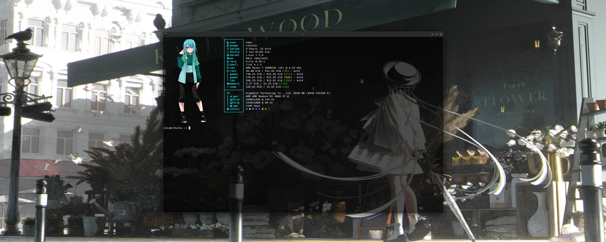

# 🐙 Cthulhu





`cthulhu` is a production-oriented, Bash-based framework for archiving and restoring Linux system metadata and user configuration across multiple distributions.

It is designed around three ideas:

- **System snapshots are distro-specific** (package inventories, distro config, kernel context).
- **Core user configs are distro-independent** (rofi, picom, dunst, kitty, zsh, etc.).
- **Window manager configs are tracked explicitly** (dwm, xmonad, plasma).

The implementation is pure Bash with standard Linux tooling, modularized for maintainability and safe-by-default restore behavior.

---

## GPU Blackbox — AMDGPU crash flight recorder (October 2026)

**[Source, installation and real crash case study](tools/gpu-blackbox/README.md)** · [Bash script](tools/gpu-blackbox/cthulhu-gpu-blackbox.sh)

A standalone systemd + udev AMDGPU diagnostic logger that records kernel events, GPU telemetry and available Linux device coredumps to a separately mounted disk. Tested on Cthulhu with an RX 9060 XT: during a S.T.A.L.K.E.R. 2 freeze the original recorder captured a 423,438-byte AMDGPU coredump automatically. The public v1.1 adds a configurable storage mount, a documented rollback and automated syntax/smoke checks. It is a diagnostic tool, **not a GPU fix**.

---

## Kanagawa Dragon desktop — NixOS + XMonad (October 2026)

**[Complete reproducible desktop setup](WM/xmonad/nixos-kanagawa-dragon/README.md)** ·
[English installation](WM/xmonad/nixos-kanagawa-dragon/INSTALL.en.md) ·
[Deutsche Anleitung](WM/xmonad/nixos-kanagawa-dragon/INSTALL.de.md).

Two routes (Plasma first or Minimal), the complete XMonad configuration, safe NixOS modules,
Fish, Kitty, Xmobar, GTK, Rofi, Dunst, audio and Fastfetch. This is an independent addition;
the backup/restore framework and historical snapshots below retain their existing roles.
External themes and artwork have separate rights; see the setup's attribution notes.

---

## Philosophy

- **Safe operations first**: restore paths are never overwritten silently; user confirmation is required.
- **Defensive and portable**: commands are checked before use; unavailable tools are skipped and logged.
- **Predictable filesystem layout**: snapshots and component archives have stable, explicit paths.
- **Simple extension model**: add distro handlers and component mappings without rewriting the CLI.

---

## Folder Structure

```text
cthulhu/
├── bin/
│   └── cthulhu
├── lib/
│   ├── detect.sh
│   ├── save_system.sh
│   ├── save_core.sh
│   ├── restore.sh
│   └── utils.sh
├── systems/
│   ├── nixos/
│   ├── gentoo/
│   ├── debian/
│   ├── arch/
│   └── unknown/
├── core/
│   ├── fastfetch/
│   ├── rofi/
│   ├── picom/
│   ├── dunst/
│   ├── kitty/
│   ├── zsh/
│   └── wm/
│       ├── dwm/
│       ├── xmonad/
│       └── plasma/
├── logs/
└── README.md
```

---

## Installation / Invocation

From repository root:

```bash
chmod +x bin/cthulhu
./bin/cthulhu --help
```

Optionally add `bin/` to your `PATH`.

---

## Commands

### Save

```bash
cthulhu save system
cthulhu save core
```

### Restore

```bash
cthulhu restore system <distro> <YYYY-MM-DD>
cthulhu restore core <component|all>
```

### List archives

```bash
cthulhu list systems
cthulhu list core
```

---

## What `save system` stores

`save system` detects distro from `/etc/os-release`, then writes into:

```text
systems/<distro>/<YYYY-MM-DD>/
```

### Gentoo

- `qlist -I` output (if available)
- `emerge --info` output (if available)
- `/var/lib/portage/world` (if present)
- `uname -r`

### NixOS

- `/etc/nixos/configuration.nix`
- `~/flake.nix` (if present)
- `nixos-version`
- `nix-channel --list` (if available)

### Debian family

- `dpkg --get-selections`
- `/etc/apt/sources.list`
- `/etc/apt/sources.list.d`
- `uname -r`

### Arch family

- `pacman -Qe`
- `pacman -Qm`
- `uname -r`

If a command is missing, it is skipped safely and recorded in `logs/cthulhu.log`.

---

## What `save core` stores

`save core` copies user components when present:

- `~/.config/fastfetch`
- `~/.config/rofi`
- `~/.config/picom`
- `~/.config/dunst`
- `~/.config/kitty`
- `~/.zshrc`
- `~/.config/dwm`
- `~/.xmonad`
- `~/.config/plasma*`

Data is archived under `core/<component>/` while preserving structure via `cp -a`.

---

## Restore Safety Model

All restore operations follow these rules:

1. **Confirmation before overwrite** for any existing target path.
2. **Automatic backup** of current target content to:
   - `~/.config/cthulhu-backup-<YYYY-MM-DD>/`
3. **Append-only action logging** in:
   - `logs/cthulhu.log`

System restore copies selected snapshot metadata to:

```text
~/.config/cthulhu-restored-system/
```

This keeps restore actions explicit and non-destructive.

---

## Logging

Every operation logs with timestamp and severity (`INFO`, `WARN`, `ERROR`) into:

```text
logs/cthulhu.log
```

This includes skipped commands, copied files, backup operations, and restore actions.

---

## Extend to New Distros

To add a new distro:

1. Add a directory under `systems/<newdistro>/`.
2. Update `normalize_distro()` in `lib/detect.sh`.
3. Add `save_<newdistro>()` in `lib/save_system.sh`.
4. Wire it into `save_system()` case dispatch.

To add new core components:

1. Add folder under `core/<component>/`.
2. Add `save_component` and restore mapping in:
   - `lib/save_core.sh`
   - `lib/restore.sh`

The CLI and utilities are already modular, so extension is local and low risk.
